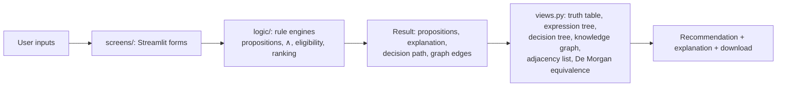

# Decision-Forge

A rule-based decision assistant built with Streamlit for **COSC-208 Discrete Structures, Fall 2026** (Instructor: Fahmina Nur Salma).
Pick a scenario, enter facts, press **Evaluate**, and get a recommendation together with the
logic behind it, not a black-box answer.

<!-- Add screenshots to docs/ and link them here, e.g.  -->

## Run it

```bash
pip install -r requirements.txt
streamlit run app.py
```

Run the tests with `pytest`.

## Scenarios

**Commute Assistant (Maya).** Compares bus, train and backup ride.
Propositions: S = service operating, F = fare within budget, D = arrives strictly before the
deadline, W = walking acceptable (within the limit and not snow).
Rule: `Eligible = S ∧ F ∧ D ∧ W`. If several options qualify, the user's priority
(earliest, cheapest, most reliable) breaks the tie.

**Login System (Sam).** A learning simulator with fictional toggles only; it never collects
real passwords or codes. P = password check passed, V = second verification passed,
L = account not locked. Rule: `AccessGranted = P ∧ V ∧ L`.

## Views shown for each scenario

Truth table (your row marked, with a reason per row), expression tree with preorder / inorder /
postorder traversals, decision tree, knowledge graph, an explanation of the result, and a
downloadable summary.

## Architecture



The logic in `logic/` has no Streamlit code, so it is tested independently of the UI.

## Project structure

```
app.py                  Homepage and navigation (entry point)
screens/                Streamlit screen for each scenario
  commute_page.py
  login_page.py
views.py                Shared truth-table, tree and graph rendering
logic/                  Rule engines (no Streamlit code)
  commute_trajectory.py   Commute rule engine
  login.py                Login rule engine
diagrams/               CampusRoute diagram generator and its output
tests/                  Unit tests
docs/                   Screenshots
```

## Usage example

1. Open **Commute Assistant**, keep the defaults (deadline 09:00, budget $10, clear weather)
   and press **Evaluate**: the train is recommended (arrives 08:30, $6, reliability 5/5).
2. Change the priority to *cheapest* and evaluate again: the bus is now recommended.
3. Switch the weather to *snow*: no option qualifies, and the explanation says why.

## Testing

`pytest` runs 25+ tests covering normal cases, boundary cases (arrival exactly at the deadline
is rejected, fare exactly equal to budget is accepted, walking exactly at the limit is accepted),
invalid inputs, traversals, graph/adjacency consistency, and changed-input cases (an outage,
a lower budget, or a different priority changes the recommendation).

## Limitations

- Rule-based prototype: it is not an AI/ML model and uses no language model.
- Commute data is entered by the user; no live transit feeds are used.
- Same-day journeys only; walking is judged by a simple total-minutes limit and "no snow".
- The login screen is a learning simulator with fictional toggles; it is not real authentication.

## Team

| Member | Contribution |
|---|---|
| Nafissatou LO | Streamlit website, homepage, project setup and structure |
| Nia Silke Tabe | CampusRoute logic, decision tree and knowledge-graph diagrams, tests |
| Mya Parker (Team Leader) | Login simulator backend |
